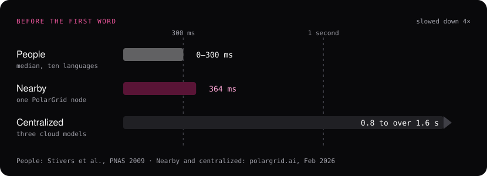
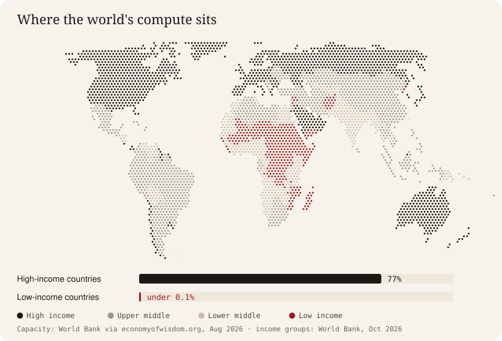

**Co-founder and VP Engineering, [PolarGrid](https://polargrid.ai)** · **President, [Economy of Wisdom Foundation](https://economyofwisdom.org)** · Vancouver, BC

Real-time AI inference at the edge. Distributed systems that scale. Frameworks that ask whether technology serves people.

## PolarGrid: served from the site nearest every user

One endpoint, global inference delivery. Each request is served from the site nearest the user, so time to first token stays low in every region.



**Why near matters.** In all ten languages studied, the median gap before people answer each other is between 0 and 300 milliseconds. Past 300 milliseconds, listeners begin anticipating a hedged response. In pre-production benchmarks published in February 2026, our voice pipeline on one nearby node had a median of 364 milliseconds from audio in to audio out. The same post estimates 0.8 to over 1.6 seconds for a chain of three centralized models.



**If a site goes down, its traffic moves to the next nearest site and the endpoint stays up.** When traffic surges in one region, nearby sites take the overflow.

<details>
<summary><b>How it works, for engineers</b></summary>
<br>

| Layer | What it does |
|---|---|
| Inference | OpenAI-compatible endpoints, autoscaling replicas, and request routing to the nearest healthy site. |
| Orchestration | Scheduling, rollouts, and failover across sites, so a deployment is described once and runs everywhere. |
| Compute | Dedicated GPU capacity, tuned runtimes, and storage paths sized for loading large checkpoints fast. |
| Hardware | Partner data centers with power, cooling, and networking we specify, accept, and operate with the site teams. |

- **Local hot path.** Anything in the hot path is local to the node. Anything that can tolerate seconds or minutes of staleness can be centralized. [Running inference across multiple colos without a central brain](https://www.polargrid.ai/blog/running-inference-across-multiple-colos-without-a-central-brain)
- **Routing.** The SDK probes candidate nodes, caches the result for five minutes, and falls back to the next-best node when a request fails. [Building a regionally-aware model router](https://www.polargrid.ai/blog/building-a-regionally-aware-model-router)
- **Voice on one node.** Speech-to-text, the language model and text-to-speech run on the same physical GPU node, so the step between stages is a memory copy. [Anatomy of a sub-400ms STT→LLM→TTS pipeline](https://www.polargrid.ai/blog/anatomy-of-a-sub-400ms-stt-llm-tts-pipeline)
- **Observability.** Per-request telemetry at every gateway, synthetic benchmarks, and model cards built from dated benchmark files. [Our inference observability stack](https://www.polargrid.ai/blog/our-inference-observability-stack)

</details>

## Economy of Wisdom Foundation: every organization moves human needs


**We measure which way.** Transmutarianism is a published framework for scoring what an organization, project or AI system does to the people it touches: the hardship it absorbs, and the fulfillment it passes on. Each dot is a field note's published reading of the public record.

<sub>Disclosure: I am VP Engineering at PolarGrid, in the market Field Note 01 evaluates Telus entering. PolarGrid provides no funding to the Foundation and has no role in its research or scoring.</sub>



**Whose values train AI?** In March 2026, 51 people in Vancouver's Downtown Eastside were interviewed in person. Asked what AI should learn from human beings, 22 of them named compassion, care or kindness first. [Read the paper](https://doi.org/10.5281/zenodo.19582415).



**Where the world's compute sits.** Low-income countries hold under 0.1% of global data-centre capacity, against 77% for high-income countries (World Bank). [Field Note 12 on open-weight labs](https://economyofwisdom.org/blog/2026-08-02-open-weight-labs/)



**A Compute Community Centre** is a modern commons based on the public library model, open to anyone who walks in. It is costed and in design, and the site is still to be chosen. [See the design](https://economyofwisdom.org/compute-community-centre/)

<details>
<summary><b>For researchers</b></summary>
<br>

- **Transmutarianism v19**, a moral accounting framework for measuring deprivation and fulfillment flows through agent networks. DOI [10.5281/zenodo.21268135](https://doi.org/10.5281/zenodo.21268135)
- **Whose Values Train AI? Evidence from 51 interviews in Vancouver's Downtown Eastside.** DOI [10.5281/zenodo.19582415](https://doi.org/10.5281/zenodo.19582415)
- **Synthetic Voices**: real speakers produce hesitation and filler at 49.4 markers per 1,000 words; the four language models tested produce between 0.25 and 6.9. DOI [10.5281/zenodo.20262752](https://doi.org/10.5281/zenodo.20262752)
- **17 field notes** that score named institutions on one reproducible map: [economyofwisdom.org/blog](https://economyofwisdom.org/blog/)

</details>

## Thinking

I believe compute infrastructure is a question of cognitive sovereignty. Who controls the inference layer shapes who benefits from AI. Who builds the infrastructure shapes the people inside it. [Take back the power to shape what shapes you.](https://economyofwisdom.org/blog/2026-06-14-who-shapes-consciousness/)

## Work that mattered

- Scaled payment authentication services **100×** at Mastercard, the services that run on every card-not-present transaction
- Built PolarGrid's infrastructure stack from scratch: two-tier Kubernetes, GPU passthrough, MetalLB, bare-metal Supermicro
- Mentored four AI startups through Scale AI's Zen Launchpad Cohort 2
- Published **Transmutarianism** (DOI [10.5281/zenodo.21268135](https://doi.org/10.5281/zenodo.21268135)), a moral accounting framework for measuring deprivation and fulfillment flows through agent networks
- Developed PITC (Physical-Information Theory of Consciousness), distinguishing crystallized intelligence from fluid consciousness in AI-integrated substrates

## Technical depth

```
Infrastructure     Kubernetes (MicroK8s, Kata containers) · MetalLB · bare metal GPU clusters
AI/ML              Triton Inference Server · Whisper · Qwen · LLaMA · Nemotron · Kokoro TTS · NVIDIA Blackwell
Cloud              AWS (Solutions Architect, Security certified) · multi-region distributed systems
Languages          Python · Go · TypeScript · Bash
Domains            Voice AI · agent orchestration · AI alignment · real-time inference · LLM serving
```

BCIT · AI Alignment · AWS Solutions Architect · AWS Security · Generative AI · PMP

## Connect

[LinkedIn](https://linkedin.com/in/past5) · [PolarGrid](https://polargrid.ai) · [Economy of Wisdom](https://economyofwisdom.org) · [Past 5 Solutions](https://past5.com)

*The real measure of any system is whether it transforms deprivation into fulfillment for the people and communities it serves.*

<sub>Graphics drawn for this profile from public PolarGrid and Economy of Wisdom pages; sources in [assets/SOURCES.md](assets/SOURCES.md).</sub>
